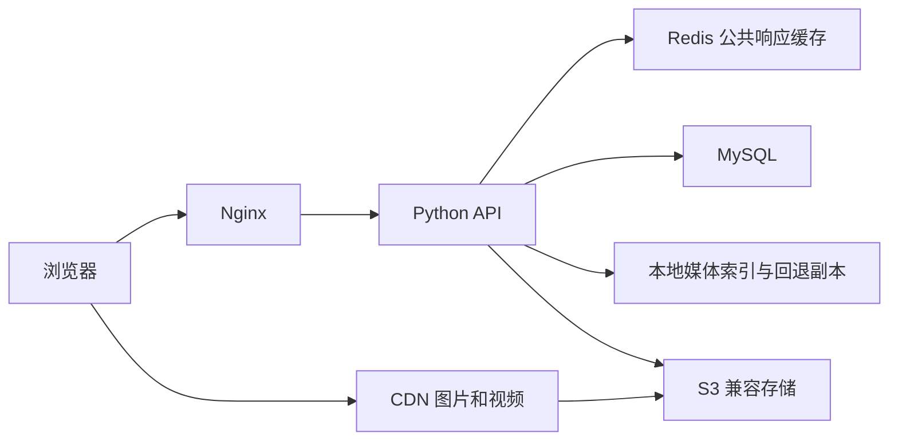

# Redis 与 S3/CDN 接入

2026-10-23 完成可选接入。默认仍为 MySQL + 本地媒体，不要求启动 Redis 或对象存储。
配置模板：`deploy/tlhdd.env.example`。已有管理后台静态文件可继续使用，无需重新安装前端依赖或重建后台。

2026-10-23 21:42（北京时间）已在正式站点启用独立 Redis，真实缓存失效及命中验证通过。按用户选择，正式站点媒体继续保存在本地，S3/CDN 暂未启用；上线验证、实测性能及回退命令见 [生产记录](../deploy/production-runbook.md)。

## 已实现的链路



- 公开 `/api/site`、新闻、页面、车辆/配件列表与详情使用 Redis cache-aside。
- 搜索、论坛、后台、登录、私信、询盘不缓存。列表只缓存前 20 页；未知参数、重复参数、搜索条件、过长参数绕过缓存。单个响应最多缓存 1 MiB。
- 公共业务表通过 `DatabaseConnection` 写入并成功提交后，轮换缓存 generation；后台、批量删除、MCP 的现有写入路径都覆盖。回滚、提交失败不失效；旧读取只能回填旧 generation，避免并发覆盖新缓存。直接在数据库外部改数据须主动失效或等待 TTL。
- 默认 TTL 60 秒，附加最多 10% 抖动。新闻定时发布可能因此延后至缓存过期才显示。缓存故障时读写绕过缓存，5 秒后重试；失效失败时旧值在 TTL 内自然过期。此方案提供有限时间内的最终一致性。
- Redis 连接/读写超时各 200ms，关闭客户端重试；64 个固定线程锁合并单进程并发未命中，最多等待 250ms。跨进程未命中仍可同时回源。HTTP JSON 继续使用 `Cache-Control: no-store`，缓存仅在服务端。
- `list_page_sections` 从 1+N 次数据库查询合并为最多 2 次，共用一个 MySQL 连接。保留后台/前台可见性与排序。
- `TLHDD_SLOW_SQL_MS` 默认 200ms；日志仅含操作名、SQL 模板 SHA-256 前 12 位和耗时，不记录参数或完整 SQL。日志覆盖执行与缓冲取数，不包含建连时间。
- 上传保留原有格式校验、大小限制、Pillow 图片检查、WebP 压缩和论坛额度；S3 模式上传原图、压缩图、缩略图及视频。16 MiB 起使用 SDK 分片传输，最多 3 个上传线程。
- 上传时校验远端大小和 SHA-256 元数据，成功后写入 `data/media-objects.db`。迁移可加 `--verify-download`，读取远端完整字节并比对 SHA-256。
- 公开 JSON 中已登记的媒体地址改为 CDN 地址；数据库及后台编辑接口保留相对路径。历史 `/uploads/`、默认素材链接可返回 302 到 CDN。没有登记、索引不可读或本地文件发生变化时继续使用本地地址。
- 媒体索引按存储 endpoint、bucket、prefix 隔离；每次响应批量读取索引，避免每张图重复建连。索引不属于业务数据库，不上传到公开目录。

## 1. 配置 Redis

安装生产依赖：`python -m pip install -r requirements.txt`。Redis 应通过回环或私网连接；不同环境使用独立前缀。设置内存上限与适合缓存的淘汰策略，例如 `allkeys-lru`，实际额度根据命中率、键数量和主机余量调整。

```ini
TLHDD_REDIS_URL=redis://127.0.0.1:6379/0
TLHDD_CACHE_PREFIX=tlhdd:production:public:v1
TLHDD_CACHE_TTL=60
TLHDD_SLOW_SQL_MS=200
```

有密码或 TLS 时使用实际连接 URL；密码中的特殊字符需要 URL 编码。不要把真实 URL 提交到仓库。重启应用后，公开响应头会显示 `X-Data-Cache: miss`，随后同样请求为 `hit`；禁用、错误或不符合条件时为 `bypass`。

缓存统计可从 Redis 自身监控与访问日志采集。generation 的历史数据键随 TTL 过期，不扫描全库或执行 `FLUSHALL`。

## 2. 配置对象存储和 CDN

按 S3 兼容 API 接入，兼容采用该 API 的 MinIO 部署。生产选用有维护保障的服务和版本。本次未安装任何 MinIO 服务。

```ini
TLHDD_MEDIA_BACKEND=s3
TLHDD_S3_ENDPOINT=https://s3.example.com
TLHDD_S3_REGION=us-east-1
TLHDD_S3_BUCKET=tlhdd-media
TLHDD_S3_PREFIX=site
TLHDD_S3_ADDRESSING_STYLE=auto
AWS_ACCESS_KEY_ID=replace-on-server
AWS_SECRET_ACCESS_KEY=replace-on-server
TLHDD_MEDIA_PUBLIC_BASE=https://media.example.com
TLHDD_MEDIA_REDIRECT=0
```

AWS S3 可省略 endpoint；兼容服务按其要求选择 `auto`、`path` 或 `virtual` 寻址。endpoint 和 CDN 必须使用 HTTPS。支持标准环境凭据和实例角色；应用不把凭据发送给前端，也不自动修改桶策略。

应用账号需要目标前缀的 `PutObject`、`GetObject`、`AbortMultipartUpload` 等 SDK 传输权限。根据供应商配置分片上传和过期未完成上传清理规则。CDN 使用独立的只读回源授权，桶内仅存放原本允许公开的媒体；业务数据库和备份不在此桶内。

CDN 回源到对象存储，而非当前 Web 服务器；把 MinIO 放在同一台 Web 主机并直接回源，仍会使用这台主机的出口带宽。CDN 开启 HTTP/2 或 HTTP/3，保留 Content-Type、支持视频 Range 请求，采用对象的 Cache-Control。通过浏览器确认图片、视频和控制台 CSP 无错误。CSP 已允许配置的媒体域名加载视频。

示例映射为：`/uploads/2026/10/a.webp` → 桶内 `site/uploads/2026/10/a.webp` → `https://media.example.com/site/uploads/2026/10/a.webp`。CDN base 表示桶根路径，不要把同一个 prefix 在 CDN 配置与环境变量里重复添加。

## 3. 迁移并逐步启用

迁移工具必须在实际保存媒体的机器上运行，使用同一服务账号及环境配置，索引文件需归服务账号所有。Windows 本地迁移不会自动把文件或索引同步到生产服务器。

先预览，无需凭据，不上传、不写索引：

```sh
python -B scripts/migrate_media.py --include-assets
```

在装有实际凭据的环境执行上传与完整字节校验：

```sh
python -B scripts/migrate_media.py --include-assets --apply --verify-download
```

扫描范围是 `uploads/`，加 `--include-assets` 后还包括 `assets/default-media/` 和 `assets/images/` 中允许的媒体。不会迁移 SQL、环境文件或源码。输出含文件数、字节数、上传数、不变数、失败数；失败返回非零退出码。再次运行会检查远端并跳过相同对象，便于断点后重跑。完整字节校验会增加读取流量。

现有 systemd 部署可用临时任务载入受保护的环境文件；无需在命令行传递密钥：

```sh
sudo systemd-run --unit=tlhdd-media-migration --wait --pipe --collect --uid=tlhdd \
  --working-directory=/srv/tlhdd -p EnvironmentFile=/etc/tlhdd/tlhdd.env \
  /srv/tlhdd/.venv/bin/python -B /srv/tlhdd/scripts/migrate_media.py \
  --include-assets --apply --verify-download
```

完成后按顺序执行：

1. 抽查 CDN 上的原图、缩略图、默认图片和视频，确认内容、HTTPS、缓存头及 Range 请求正常。
2. 将配置模板中两个媒体 `location` 合并进实际 Nginx 配置，核对真实后端端口，执行 `nginx -t` 再 reload。它们必须出现在通用静态图片正则之前；旧的 `try_files` 会绕过应用的 CDN 跳转。现有部署脚本不自动替换线上 Nginx 配置。
3. 设置 `TLHDD_MEDIA_REDIRECT=1` 并重启应用。检查 `/api/site` 的媒体域名和历史链接的 302；后台新上传仍返回相对 URL，保存及预览保持兼容。
4. 确认 CDN 请求占比提升、Web 主机出口流量下降、接口返回和后台写入正常，再保持该配置。

本次默认保留本地文件：供即时回退和现有缩略图发现使用。不要手工清空 `uploads/`。此阶段主要卸载下载带宽，没有实现本地磁盘清空。

上传仍先经过应用进行校验、额度检查和图片处理，再转存 S3；浏览器直传、大于现有限制的文件及转码队列尚未实现。分片并发发生在应用到存储的传输。CDN 负责面向用户的并发分发。

已有随机上传文件名可长缓存。修改同名对象或重新生成同名缩略图时应刷新对应 CDN 缓存；优先上传为新文件名再修改页面引用。迁移工具不自动清除 CDN 缓存，也不删除旧对象。

## 4. 性能验证与回退

在相同数据和网络条件下，分别记录禁用/启用缓存的公开接口耗时与查询数：

```sh
python -B scripts/benchmark_public_api.py http://127.0.0.1:4174/api/site --requests 30
```

工具输出首次请求、P50、P95、缓存头计数和响应大小。浏览器记录首屏图片时序，CDN/源站监控记录命中率与出口流量；不要用本机单次耗时代替公网验证。慢查询仍需用 MySQL 慢查询日志与 `EXPLAIN ANALYZE` 检查真实过滤条件和索引，Redis 不能替代查询优化。

回退：清空 `TLHDD_REDIS_URL`、设 `TLHDD_MEDIA_REDIRECT=0`、设 `TLHDD_MEDIA_BACKEND=local`，重启应用。保留本地副本时无需改数据库。CDN 故障不会自动探测并回源本地，需要按上述开关切换；S3 写入失败返回 503，论坛会释放预留上传额度。

媒体备份仍包含 MySQL、`uploads/`、对象存储及 `data/media-objects.db`。索引丢失时可通过重新迁移重建；恢复或重新复制本地媒体后也应重新迁移以登记当前文件时间。应用业务数据仍只在 MySQL，SQLite 仅记录媒体发布状态。

## 本地验证记录

- 34 项基础设施测试、8 项既有新闻测试通过。
- 使用 redis-py + 本机 FakeRedis 协议服务、boto3 + Moto S3 模拟服务验证；测试不访问真实生产数据库、对象存储或 CDN。
- 覆盖提交后失效、回滚和并发读取竞态、缓存故障回退、媒体校验和完整下载比对、幂等迁移、分片传输、图片派生文件、论坛额度回滚、HTTP GET/HEAD 跳转、CSP 与鉴权隔离。
- 迁移预览：2,086 个文件，295,892,291 字节（约 282 MiB）；未实际上传。
- 发布文件校验、Python 语法及 `assets/js/main.js` 语法检查通过；未在本机执行 Nginx 配置检查或真实云服务压测，部署时需完成联调。

实现参考：[Redis cache-aside](https://redis.io/docs/latest/develop/use-cases/cache-aside/)、[boto3 文件传输配置](https://docs.aws.amazon.com/boto3/latest/guide/s3.html)。
